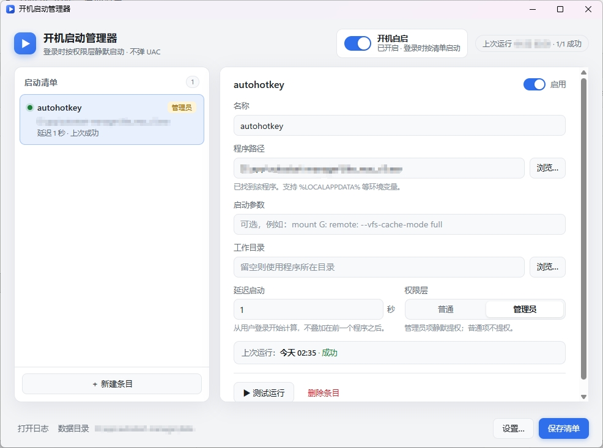

# 开机启动管理器 · WinAutoStartManager

[](LICENSE)

一个单文件 Windows 小工具：用图形界面维护启动清单，在**用户登录时**按「管理员 / 普通」两个权限层静默启动指定程序。登录阶段**不弹 UAC**。



> 界面用 WebView2 渲染内嵌 HTML/CSS/JS，无前端构建步骤、无安装程序、无常驻托盘。

## 它解决什么问题

Windows 自带的自启动管理很粗糙：要么全部提权（连带普通程序也拿到管理员令牌），要么全部不提权。需要 `AutoHotkey`、`rclone mount` 这类必须管理员权限的程序时，常规做法是丢一个快捷方式进启动文件夹——登录后必然弹 UAC，而且没人坐在电脑前点确认。

本工具把清单拆成两个计划任务，登录时静默执行：

| 权限层 | 运行级别 | 行为 |
| --- | --- | --- |
| 管理员 | HighestAvailable | 真正提权，登录时不弹 UAC |
| 普通 | LeastPrivilege | 保持普通权限，不被连带提权 |

## 核心特性

- **零 UAC 登录启动** — 只有开启/关闭「开机自启」时需要确认一次。
- **条目设置完整** — 名称、路径、启动参数、工作目录、延迟秒数、权限层、是否启用。
- **延迟是绝对时刻** — 从用户登录开始计算，不在前一个程序之后累加。
- **改清单不用重装** — 计划任务只存 exe 路径，清单在登录时读取，增删改条目后无需重新应用任务。
- **失败可见、成功静默** — 失败弹一条 Windows 通知并写日志。
- **状态可靠** — 开关状态与真实计划任务一致；查询失败显示「状态未知」，不误报为「未开启」。
- **无控制台闪窗** — 打开管理器、登录启动、切换启停都不闪 cmd 黑框。
- **草稿 + 显式保存** — 未填完的条目可保存但不参与启动；改动需 `Ctrl+S` 或点「保存清单」，关闭有未保存修改时会确认。
- **高 DPI** — Per-Monitor V2 感知，125% / 150% / 200% 及跨屏切换均按原生分辨率渲染。
- **数据目录可迁移** — 默认 `%LOCALAPPDATA%\AutoStartManager`，可改到任意文件夹，日志保留天数可调。

## 环境要求

- Windows 10 / 11（x64）
- Microsoft Edge WebView2 运行时（Windows 11 自带；Windows 10 缺失时安装 Evergreen Runtime）
- 仅从源码构建时需要 Go 1.27+（以 `go.mod` 为准）

## 快速开始

1. 获取 `WinAutoStartManager.exe`（从 Releases 下载，或按下文自行构建）。
2. 双击运行。首次可能被 SmartScreen 拦截（未做代码签名），选择「更多信息 → 仍要运行」。
3. 点「新建条目」，选择程序、填参数与延迟；需要提权的把权限层切到「管理员」。
4. 点「保存清单」（`Ctrl+S`）。
5. 打开右上角「开机自启」开关，UAC 确认一次。
6. 下次登录 Windows，清单中的程序自动静默启动。

## 构建

Linux / macOS / WSL 上交叉编译：

```bash
./build.sh
```

Windows 本地构建：

```powershell
$env:CGO_ENABLED="0"
go build -trimpath -buildvcs=false -ldflags "-s -w -H windowsgui" -o WinAutoStartManager.exe .
```

`-H windowsgui` 让程序启动时不带控制台窗口。`-buildvcs=false` 与 `-trimpath` 共同保证**不同环境产出逐字节相同的包**；不加则每次 clone 的 hash 都不同。图标资源已随仓库提供（`rsrc.syso`），clone 后无需重新生成。

验证产物：

```bash
sha256sum WinAutoStartManager.exe    # 当前应为 c39ee321...ecda14
```

## 文档

| 文档 | 内容 |
| --- | --- |
| [docs/USAGE.md](docs/USAGE.md) | 安装、界面说明、条目字段、开关状态、设置、数据目录、卸载 |
| [docs/TROUBLESHOOTING.md](docs/TROUBLESHOOTING.md) | 闪黑框、状态未知、SmartScreen、WebView2 缺失等故障 |
| [docs/BUILD.md](docs/BUILD.md) | 可复现构建、图标资源生成、发布检查清单 |
| [docs/DEVELOPMENT.md](docs/DEVELOPMENT.md) | 包结构、权限模型、任务状态机、GUI 架构、测试与内部约定 |

## 已知限制

- 未做代码签名，首次运行可能被 SmartScreen 拦截。
- 移动或重命名 exe 后，开关会显示「需更新」，重新开启一次即可。
- 登录触发在用户会话建立之后，登录前（服务阶段）启动不支持。
- 自定义数据目录放在可移动磁盘上时，登录时磁盘不可用会导致本次启动失败并通知。
- 标准用户无法创建最高权限任务，管理员层需要当前账户属于 Administrators 组。

## 许可

[MIT License](LICENSE) © 2026 xyz4445

你可以自由使用、修改、分发本项目，包括商业用途，只需保留版权声明与许可文本。软件按「原样」提供，不附带任何担保。
